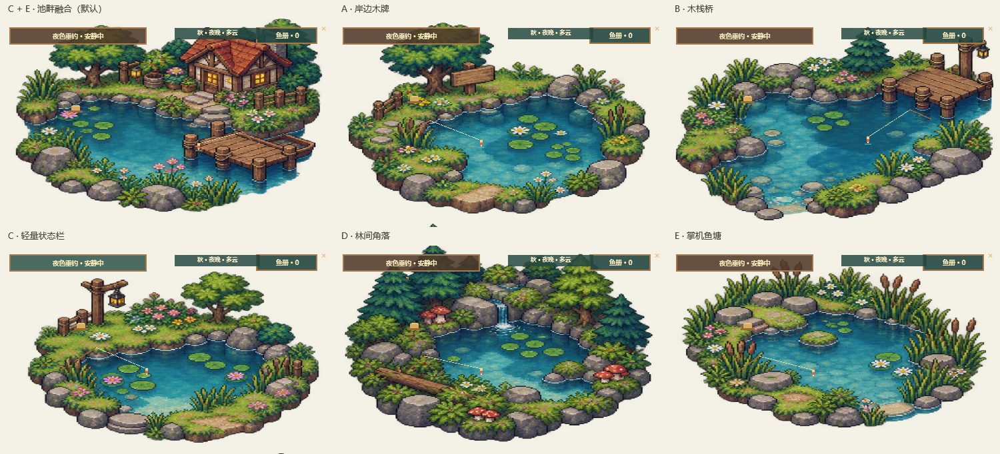

# Codex Pond

[简体中文](README.md) · [English](README.en.md)

**A small pixel-art pond that turns completed agent turns into fish for your collection.** Codex Pond has a Windows desktop pond and a standalone macOS window; both support offline fishing and an optional local Agent task panel.

[Download the Windows x64 portable preview](https://github.com/a2098127101-droid/codex-pond/releases/download/v0.1.0-preview.1/CodexPond-win-x64.zip) · [SHA-256 checksum](https://github.com/a2098127101-droid/codex-pond/releases/download/v0.1.0-preview.1/SHA256SUMS.txt) · [Source ZIP](https://github.com/a2098127101-droid/codex-pond/archive/refs/heads/main.zip) · [All releases](https://github.com/a2098127101-droid/codex-pond/releases)



> This is a static design preview, not a recording of runtime interaction or a desktop acceptance test.

## What it does

- Keeps a compact, draggable pixel pond on the Windows desktop, with six original scene layouts, a fish book, seasonal palettes, local weather, and occasional events.
- The macOS client provides a standalone pond window with the same fish book, six themes, equipment, and fishing loop. It does not yet provide the Windows transparent desktop click-through overlay.
- Includes standalone fishing without an Agent. After a bite, keyboard or mouse input controls line tension; a relaxed assist mode is available. Agent mode still awards exactly one fish per confirmed successful turn, regardless of the minigame.
- The fish book lists all 20 species, with silhouettes and season/time clues for undiscovered fish plus filters. Seasonal events recur and have no streaks or missed-event penalties.
- First-catch, four-season discovery, and full-collection milestones unlock local decorations. Steamworks stats report these milestones on Windows; the Mac build currently keeps progress local.
- Implements connectors for Codex App Server, DeepSeek Harness headless CLI, and Claude Code with a configured Work Buddy MCP gateway. One confirmed successful Agent turn earns one fish. Failed, cancelled, disconnected, or uncertain turns do not.
- Uses original fish and scene art. Seasonal ambience follows local time and month; the app does not fetch weather data.
- Can count anonymous keyboard/mouse activity pulses during an active Agent turn to affect fish rarity. Input contents, coordinates, target applications, and per-input history are not saved. The option can be disabled.
- Stores the fish book and settings locally. When configured, Steam cloud data is limited to game progress and settings; Agent prompts, conversations, working directories, logs, and credentials are excluded.

## Download and run

1. Download `CodexPond-win-x64.zip` from the link above.
2. Extract it and run `CodexPond.exe`.
3. For Agent mode, install and sign in to the selected provider separately. Codex Pond does not bundle provider CLIs or credentials.

The preview package is a self-contained Windows x64 build. The executable is currently unsigned, so Windows may display a publisher or SmartScreen warning. Review the source and the published SHA-256 checksum before running it.

### Source-level “Cyber Buddha” mark

Run `CodexPond.exe --cyber-buddha-stamp` to view the source mark ID, version, and SHA-256 fingerprint of the current executable. Compare the fingerprint only with the checksum manifest for the matching version in the [official GitHub Releases](https://github.com/a2098127101-droid/codex-pond/releases); locally built binaries normally have different hashes from release binaries. The currently published preview package does not include this option; it takes effect with a build that contains this change. The mark is not drawn in the pond. A locally displayed hash is not a digital signature and cannot prevent a binary from being modified.

The Buddha itself is an ASCII string in the shared source file `CyberBuddhaSeal.cs`; Windows can show it with the command above, and the Mac client has a “Source Mark” button. It is a programming joke, not a bug-free or security guarantee.

## macOS build

The Avalonia client is in `macos/CodexPond.Mac`, sharing the .NET gameplay and Agent components. The target is macOS 14+. Build a self-contained app bundle with the .NET 8 SDK:

```bash
bash macos/build-macos.sh osx-arm64
# For Intel Macs:
bash macos/build-macos.sh osx-x64
```

The `.app` is written under `artifacts/macos/`. macOS GitHub Actions creates 30-day downloadable unsigned zip artifacts for both ARM64 and Intel x64; download them from the Artifacts section of the matching Actions run. Development bundles are unsigned and not notarized, so macOS may block them. Sign and notarize with an Apple Developer ID before public distribution. A source build is not Mac hardware acceptance: provider login, approval MCP, display scaling, signing, and notarization still require validation on a target Mac. Steamworks, the Windows transparent desktop click-through overlay, and Windows tray behavior remain Windows-only.

## Provider and Steam status

The Codex, DeepSeek Harness, and Work Buddy connector implementations are included. Automated smoke coverage uses fake CLI/App Server/MCP event streams. Real provider end-to-end acceptance is still pending and requires the user's own CLI, sign-in, MCP setup, and approvals. No provider credentials are included.

Steamworks.NET integration code and SteamPipe preparation scripts are included. Live Steam achievements and cloud saves have not been verified. A Steamworks redistributable (`steam_api64.dll`) and Steamworks App/Depot configuration are still required; this preview is not a Steam release.

Transparent-region click-through, multi-monitor DPI behavior, and hands-on desktop interaction have not been fully accepted on target hardware.

## Build from source

Windows requirements: Windows 10/11 x64 and .NET 8 SDK. Mac requirements: macOS 14+ and .NET 8 SDK.

```powershell
dotnet restore .\CodexPond.sln -p:RestoreSources=https://api.nuget.org/v3/index.json -p:NuGetAudit=false
dotnet build .\CodexPond.sln -c Release
```

The smoke project is in `tests/CodexPond.Smoke`. Fake provider tests do not prove real provider authentication or runtime compatibility.

GitHub Actions restores and builds the Windows solution and runs its smoke suite. A separate macOS runner creates self-contained `.app` download artifacts for both ARM64 and Intel x64; this validates those packaging targets but does not replace Mac sign-in, window, and permission-flow acceptance.

## Privacy and permissions

- Provider CLIs use their own local sign-in, sandbox, and approval settings.
- Codex Pond does not read credential files or auto-approve provider requests.
- The activity option counts temporary anonymous pulses only while an Agent turn is active; it does not persist the count.
- Local fish-book and settings are stored under `%LOCALAPPDATA%\CodexPond` on Windows and `~/Library/Application Support/CodexPond` on macOS.

## Project license

No license has been selected for the Codex Pond project yet. Third-party notices are in [`THIRD-PARTY-NOTICES.txt`](THIRD-PARTY-NOTICES.txt) and [`THIRD-PARTY-NOTICES-DOTNET.txt`](THIRD-PARTY-NOTICES-DOTNET.txt). Please review them separately.

## Inspiration and attribution

The calm seasonal mood takes inspiration from pixel-art life-simulation games, and the work-to-visible-reward loop takes inspiration from [喵了个菜！](https://store.steampowered.com/app/4201710?l=schinese). All Codex Pond scenes, interface elements, and fish sprites are original; no game art or interface assets are included.

